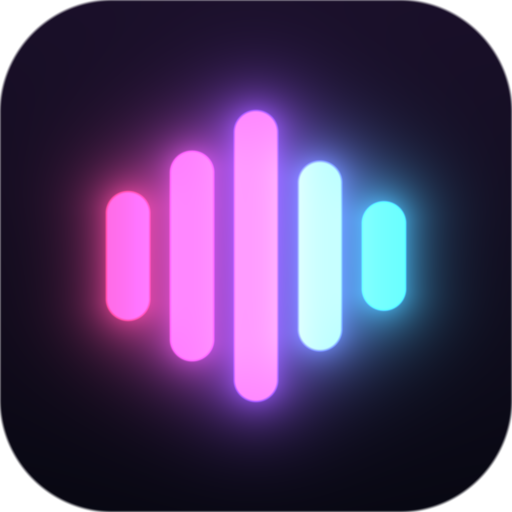

<p align="center"></p>

# Beatlumen

Beatlumen is a music player that turns your songs into beat-synchronised
visuals: background images come alive with camera moves, particles, light and
colour effects that follow the rhythm and the structure of every track.
It is an open-source successor to the discontinued *Hyperchroma* and reads
its `.hfx` preset files.

*Deutsch:* Beatlumen ist ein Musikplayer, der deine Songs in rhythmische
Visuals verwandelt. Er läuft unter Linux, Windows, Android und im Browser,
spielt lokale Dateien ab und streamt von deinem eigenen Beatlumen-Server.

## Features

- Plays MP3, AAC/M4A, ALAC, Opus, Vorbis, FLAC, WAV/AIFF and Matroska/WebM
  audio with its own decoders (written in Rust).
- Audio analysis finds beats (lows, mids, highs) and song sections; effects
  react to both. *Adaptive* mode keeps quiet parts calm and lets drops hit.
- Styles (presets) with camera, particle, filter and transition effects, an
  intensity control and a full editor for every effect.
- Library with songs, albums, artists, folders, playlists and a play queue;
  artist and title are guessed from file names when tags are missing.
- Background images from your folders, the server or the album cover.
- **Song texts** over the visuals: from the file's tags, an `.lrc` or
  `.txt` file next to it, or added in the app. Synced texts (LRC, also with
  word timing) follow the song; tapping a line jumps there.
- **AirPlay receiver** (optional): the app appears as a speaker on iPhone,
  iPad and Mac and plays and visualises what they send, with title, artist
  and cover (Linux, Windows, Android; AirPlay 1 protocol).
- **DLNA/UPnP receiver** (optional): apps such as BubbleUPnP, Windows
  "Play to" and other control points can send music to the app and control
  it (play, pause, seek, volume, next track).
- **Play on speakers in the network**: AirPlay 1 receivers (AirPort
  Express, AV receivers, shairport-sync, …; encrypted when the speaker
  supports it), DLNA/UPnP renderers (TVs, AV receivers, …) and Chromecast
  devices; the last two fetch a live stream from the app. The visuals stay
  in sync with the speaker.
- **Visualize other apps** (Android 10+, Linux, Windows): music from
  Spotify, YouTube, radio apps, the browser and others drives the visuals;
  their title and cover are shown and they can be controlled from the app
  (on Android, apps that block recording stay silent, their controls still
  work).
- **Server extensions** (`docs/EXTENSIONS.md`): separate programs can add
  music sources to the server, e.g. search a video platform; the song plays
  right away while the server stores it, with intros and outros left out,
  in the shared library or the user's encrypted files.
- System media controls and media keys: MPRIS on Linux, the media
  overlay on Windows, the media notification and lock screen on Android.
  After the app was closed, Android's media controls continue the last
  track where it stopped.
- **Public links** to encrypted files, with expiry and an optional
  password: the receiver opens the file in a browser without an account;
  the key is part of the link and never reaches the server.
- **Encrypted files on the server** (end-to-end): only you and the people
  you share with can open them; sign in with a password, passkeys or your
  password manager (`docs/ENCRYPTION.md`).
- Light/dark mode and accent colour follow your system.
- **Beatlumen Server** shares a music folder on your network and serves the
  web version of the app.

**Privacy:** the apps only ever connect to the server you configure; the
server connects only to remote sources its admin sets up (none by default).
No tracking, no telemetry.

## Platforms and downloads

| Platform | Build |
|---|---|
| Linux | `apps/beatlumen` (Qt 6, CMake); `./build-appimage.sh` → `dist/linux/Beatlumen-x86_64.AppImage` |
| Windows | same, built by CI with MSVC (`windeployqt`) → installer `Beatlumen-Setup-x64.exe` (Inno Setup, `apps/beatlumen/windows/beatlumen.iss`) and a portable zip |
| Android | `./build-android.sh` → `dist/android/beatlumen.apk` |
| Web | `./build-web.sh` → `dist/web`, served by the server |
| Server | `cargo build --release -p beatlumen-server`; container image for Docker/Podman with `compose.yml`, AppArmor and SELinux profiles: [`container/`](container/README.md) |

## Building

Requirements: Rust (stable), CMake ≥ 3.21, Ninja, Qt 6.11 with Qt Multimedia
(desktop; Android plays through AAudio), Qt Shader Tools and Qt Image Formats.

```sh
# Desktop app (Linux / Windows)
cmake -S apps/beatlumen -B build/desktop -G Ninja -DCMAKE_BUILD_TYPE=Release \
      -DCMAKE_PREFIX_PATH=/path/to/Qt/6.11.3/gcc_64
cmake --build build/desktop
./build/desktop/beatlumen [--server http://host:7878] [files...]

# Server
cargo build --release -p beatlumen-server
./target/release/beatlumen-server --music ~/Music --web-dir dist/web [--password secret]

# Web version (needs emsdk 4.0.7 and Qt for WebAssembly, single-threaded)
EMSDK_DIR=~/emsdk ./build-web.sh

# Linux AppImage (downloads pinned linuxdeploy releases into build/tools)
./build-appimage.sh

# Android (needs the Android SDK/NDK and Qt for Android)
./build-android.sh
```

The CMake build compiles the Rust core (`crates/bl-ffi`) through cargo
automatically. Tests: `cargo test --workspace --release` (some tests generate
fixtures with ffmpeg and are skipped without it).

## Architecture

```
apps/beatlumen          Qt Quick user interface (QML + a small C++ bridge)
apps/beatlumen-server   HTTP server: library, streaming, analysis, web app
crates/bl-core          player, library, queues, styles, visualizer (JSON command API)
crates/bl-ffi           C interface of bl-core for the Qt app
crates/bl-fx            effect engine (triggers, camera, particles, transitions)
crates/bl-render        OpenGL / OpenGL ES / WebGL 2 renderer
crates/bl-analysis      FFT, beat and section analysis
crates/bl-media         containers, tags, resampling; codecs in bl-mp3, bl-aac,
                        bl-opus, bl-vorbis, bl-flac, bl-ogg
crates/bl-gl            OpenGL bindings (loaded at run time)
crates/bl-net, bl-json, bl-image   HTTP, JSON and image codecs
crates/bl-vault         end-to-end encryption of the user's files (+ bl-vault-wasm)
crates/bl-airplay       AirPlay (RAOP) receiver and sender: RTSP, audio, mDNS
crates/bl-upnp          DLNA/UPnP: control point and media renderer
crates/bl-cast          Google Cast sender (Cast v2)
```

Apart from the cryptography of the encrypted files (audited RustCrypto
crates in `bl-vault`, pinned versions), the Rust crates use no third-party
crates. See `docs/ROADMAP.md` for planned features (lyrics, devices, music
sources).

## Security

See [SECURITY.md](SECURITY.md) for the security model (input limits,
server protections, HTTPS and certificate trust) and how to report a
vulnerability.

## License

GNU Affero General Public License v3.0 or later (AGPL-3.0-or-later).
Third-party material and its licenses are listed in
[THIRD_PARTY_NOTICES.md](THIRD_PARTY_NOTICES.md).

If you run a modified `beatlumen-server` for other people, the AGPL requires
you to offer them the source code of your version: start the server with
`--source-url <link to your source>`. The web app shows that link under
Settings → About.
Beatlumen is not affiliated with Hyperchroma and contains none of its code
or assets.
